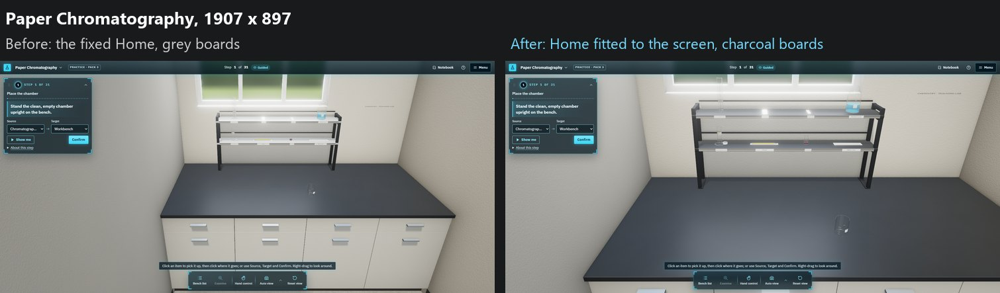
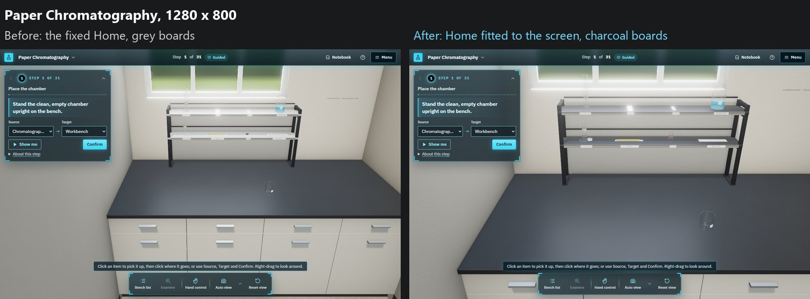
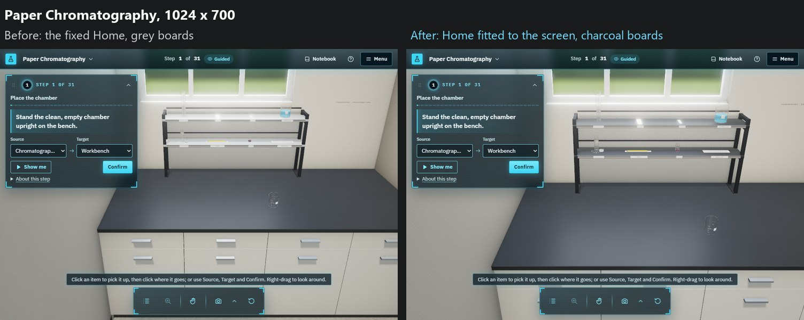
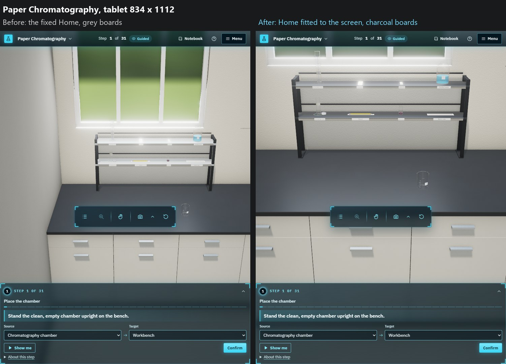
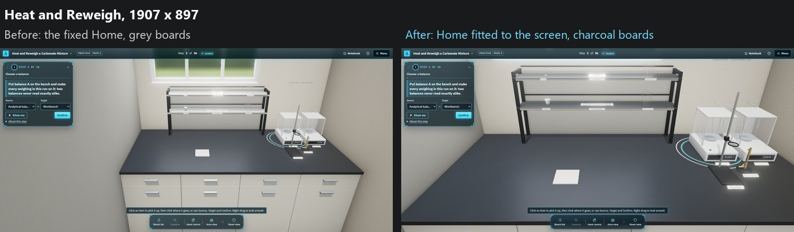
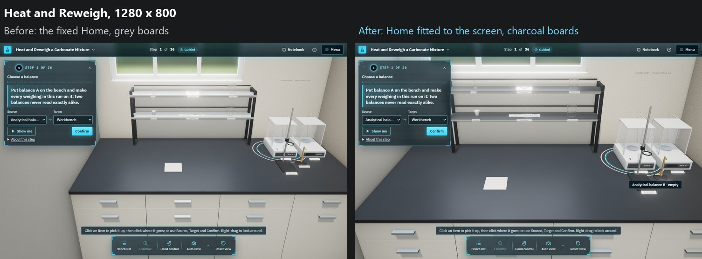
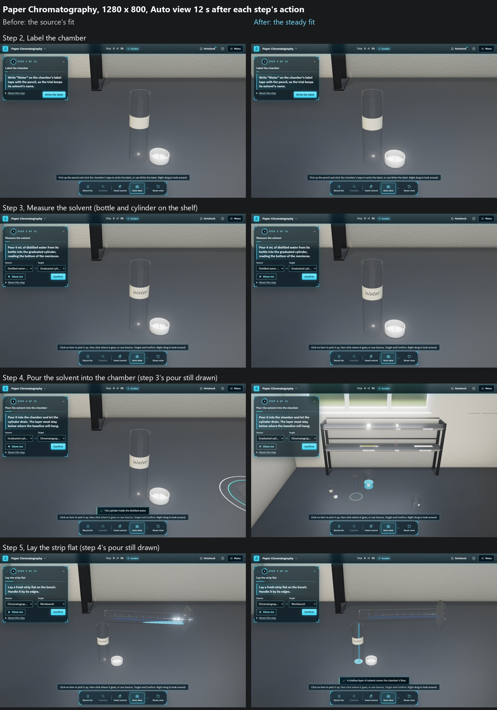
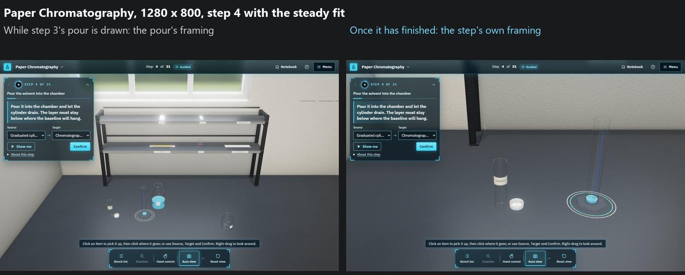
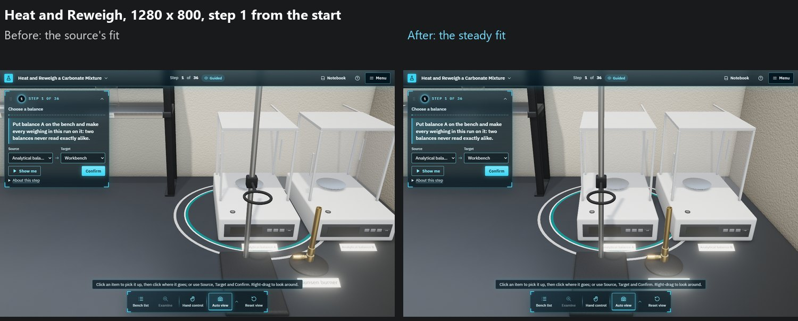

# Home fitted to the screen, Auto view's fit, and charcoal shelf boards: evidence (2026-10-12/13)

You sent a screenshot of Paper Chromatography's practice version at about 1907 × 897 and wrote: "This is the most comfortable position before the bench but the equipment is small and difficult to notice. Maybe to increase the size of the equipment at this viewport?" Asked how, you answered "Fit Home to the screen (Recommended)", for the side station "Only when it holds items (Recommended)", and for contrast "Charcoal shelf boards (Recommended)".

3D only. 2D is unchanged: nothing under `src/player/**` or `src/styles/app.css`, and no content or generator. Not pushed or published.

## The renders

Home in the HUD theme, before and after, from the same start (the first step; the Home key pressed, then 9 s to settle). Before is the fixed Home and the grey boards, put back for the capture only.

In the page itself, a probe read the camera after the Home key: Heat and Reweigh at 1280 × 800 came to the look-at point (-0.16, 0, -0.43) m at 29.3 units, as `homeView` computes. There the four station items make the scene as wide as the free stage, so the shelf's left upright comes up to the step card's edge. The balance's label in that render is a hover tooltip, from where the capture left the pointer.

## Home fitted to the screen

**What Home is now.** Home keeps its angle: looking down at 0.45 rad (about 26°), straight along the bench (yaw 0). From there the camera comes as close as still shows what Home must, inside the free stage: right of the step card and any open panel, below the top bar and above the dock and its hint. Real sizes are kept. Only the camera moves, so on a wide screen everything is drawn larger.

**What Home must show** (`bench/camera/home.ts`):

- the working area (1400 × 700 mm);
- the reagent shelf from its feet to its top, the back rod at 580 mm (`SHELF.heightMm`, checked against the model's bounds);
- everything standing on its tiers, each to its full height;
- the side station's items, only when it holds any. An empty side station is left out, so the bench comes closer.

Items count by their shelf spots, not their models, so Home neither waits for a model nor shifts as one loads. An item taken from the shelf to the bench no longer counts; the working area already holds it.

**Where it applies.** The Home key, Reset view, and the start: the bench is first shown from Home, and the first step's Auto view frames from there. The fixed Home (`DEFAULT_VIEW`, fitted by hand at 1024 × 700) stays as Home's angle and its fallback, used where nothing fits. Home stays within the wheel's range (34 units), so zooming out from it never snaps in. The Studio's bench views are unchanged.

**How much larger.** On-screen size compared with the fixed Home, for a thing standing at each place. These are computed from the camera, with the real stage: the 52 px top bar, the step card to 354 px across and 359–381 px down, and the dock's hint, the lowest edge, at 777, 680 and 580 px down at the three laptop sizes.

| Technique (station items) | Viewport | Upper tier | Bench middle | Bench front |
|---|---|---|---|---|
| Paper Chromatography (0) | 1907 × 897 | ×1.51 | ×1.57 | ×1.67 |
| | 1440 × 900 | ×1.45 | ×1.50 | ×1.59 |
| | 1280 × 800 | ×1.41 | ×1.44 | ×1.52 |
| | 1024 × 700 | ×1.20 | ×1.22 | ×1.25 |
| Drying practice (0) | 1907 × 897 | ×1.74 | ×1.83 | ×2.01 |
| Filtration (1) | 1907 × 897 | ×1.45 | ×1.50 | ×1.59 |
| Transmittance of a Dilution (1) | 1907 × 897 | ×1.45 | ×1.50 | ×1.59 |
| Heat and Reweigh (4) | 1907 × 897 | ×1.64 | ×1.72 | ×1.86 |
| | 1280 × 800 | ×1.17 | ×1.18 | ×1.21 |
| | 1024 × 700 | ×0.99 | ×0.99 | ×0.99 |

**Less than I estimated.** Before building I told you to expect about 1.7–1.85 times at 1907 × 897. For Paper Chromatography it is about 1.5 times at the shelf and 1.6 at the bench. My estimate took the shelf's front face only. What binds on a wide screen is height: the tall cylinder and the distilled water's container on the upper tier stand well above the shelf, and from their tops down to the working area's front edge must fit between the top bar and the dock's hint. The screen has room left and right. Where the upper tier holds only short items (Drying), the gain reaches about 1.8 at the bench. Heat and Reweigh at 1024 × 700 stays about as it was: Home now takes in its four station items right of the step card, about 6 % farther back than the fixed Home, with the look-at point moved back so things look the same size.

## A finding: the source's fit does not settle at pitch 0.45

The fit ported from the microarray lab (`fit`, `framing.js:29-50`) moves the look-at point and the distance together. From a low pitch, with points spread far back and high (the shelf behind the working area), that overshoots: it swings between too near and too far for all of its 14 steps and stops wherever the last step lands. With Home's marks at 1280 × 800 its steps alternated between about 60 % and 200 % of the free area's size, and it ended on whichever came last.

Home therefore uses a **steady fit** (`fitSteady` in `benchCamera.ts`). At a given distance the look-at point alone centres the points, a near-linear move that settles in a few steps. The distance is then the least at which they fit, found by bisection. A new test shows the source's fit leaving points outside the free area where the steady fit keeps them inside, and as close as they fit.

**Auto view had the same weakness.** Auto view framed each step with the source's `fit` (through `fitBest`), from the current angle. Home's angle has been pitch 0.45 since you asked for a lower Home camera (2026-10-12), so Auto view has framed from that low angle since then. Measured at 1280 × 800, framing an item together with a shelf item left the view about 200 px under the step card, and a pair at the front of the bench came out far too close. At the source's own pitch (about 0.9) the fit is mostly right. Asked whether to switch Auto view to the steady fit, you answered "Switch Auto view (Recommended)". The next section is that change.

## Auto view with the steady fit (2026-10-13)

**What changed.** Auto view now frames with `fitBestSteady` (`benchCamera.ts`). As before, it takes the free rectangle that shows the step's items largest, but it fits each rectangle with the steady fit. Both of Auto view's framings pass `steady` to `frameItems`: each step's framing (`frame()` in `Player3D.tsx`) and the framing of a committed pour while it is drawn. Two cases keep the earlier behaviour:

- **Nothing fits.** Where the items fit no free rectangle even at the wheel's farthest (34 units), the source's fit frames them as before. The steady fit only centres at a given distance, and it cannot settle on a set larger than the rectangle. A "farthest, centred" fallback was tried and dropped: at some limits it left points outside.
- **Too far out.** A view whose look-at point lies past `FRAME_REACH` (about 1.31 m across, 0.84 m deep) is dropped, as `fitBest` already drops one. Then the camera stays where it is.

Examine, the camera menu's Selected view and picking an item from the Bench list still use the source's fit, as do the Studio's bench views. They frame one item from wherever you are, so they were not part of Auto view's question.

**Measured from the start.** In the page, a probe framed each set from the start view (Home, pitch 0.45) with both fits, at Auto view's margin (1.6). "Outside" counts the pixels that run past the free area right of the step card.

| Technique, viewport | Items framed | Source's fit | Steady fit |
|---|---|---|---|
| Paper Chromatography, 1280 × 800 | sink-waste beaker | 76 px outside, on the right | inside, fills 97 % |
| | sink-waste beaker + graduated cylinder (shelf) | 273 px outside, under the step card | inside, fills 93 % |
| | sink-waste beaker + chamber (shelf) | inside, fills 100 % | the same |
| Paper Chromatography, 1907 × 897 | sink-waste beaker + chamber (shelf) | 498 px outside, past the canvas's left edge | inside, fills 95 % |
| | sink-waste beaker + graduated cylinder (shelf) | 192 px outside | inside, fills 98 % |
| Heat and Reweigh, 1280 × 800 | heat-safe pad, each balance, pad + balance A | inside | the same, within 20 px |
| | pad + balance B | 26 px outside at the farthest | the same: nothing fits, so the source's fit |
| Paper Chromatography and Transmittance, 1280 × 800 | one shelf item alone | none: the camera stays | the same |

**In the renders.** Paper Chromatography at 1280 × 800, steps 2 to 5, each captured 12 s after the previous step's action. The "before" side puts the source's fit back for the capture only.

- Step 2 (label the chamber): both frame the chamber and its lid, nearly alike.
- Step 3 (bottle to cylinder, both on the shelf): both stay on step 2's view, as neither fit frames items that are only on the shelf (below).
- Step 4: step 3's pour is still being drawn, and the step's framing waits for it (§5.9), so this is the pour's own framing. Before, it stayed on the chamber, with the pour off the screen to the right. After, it takes in the shelf, the bottle and the cylinder.
- Step 5: step 4's pour is still being drawn in both, from nearly the same view.

Once step 3's pour has finished, Auto view frames step 4 itself: the graduated cylinder and the chamber, right of the step card. Computed in the page there, the two fits agree within 1 % (9.1 and 9.2 units, the same look-at point). In the software-rendered test browser the pour was still being drawn well after 12 s, so this capture was taken later.

Heat and Reweigh at 1280 × 800, step 1 from the start. Before, balance B runs off the right edge and the burner reaches down to the dock's hint; after, the camera stands a little farther back and both balances, the stand and the burner are inside the free area. The burner's label in the "before" capture is a hover tooltip. Paper Chromatography's and Transmittance's first steps are unchanged, as their items are on the shelf.

**Found while checking: steps whose items are all on the shelf.** Auto view does not move for them (step 3 above, and the first steps of Paper Chromatography and Transmittance). For the shelf, both fits put the look-at point about 1.1 m behind the bench, past `FRAME_REACH`, so the camera keeps the previous step's view, and the step's items may be out of sight. This was so before the switch and is not changed here.

## Charcoal shelf boards

The reagent shelf's two boards now take the worktop's black-charcoal epoxy: its colour (#2a2c2e) and its satin sheen (roughness 0.36), in place of the model's mid-light grey phenolic (decided 2026-10-11). The frame (black powder coat) and the label rails (brushed stainless) are unchanged. The model has no texture coordinates, so the boards take the epoxy's colour without its faint mottle, which is too fine to see at the shelf anyway. The change is in the viewer's material settings (`bench/look/materials.ts`), so the shelf model and its Blender module are unchanged.

**In the renders.** Median brightness (0–255) at 1907 × 897: the boards were 235 (upper) and 219 (lower), close to white; now they are 182 and 114, with the worktop at 92–109. The lower board now reads as the worktop's charcoal. The upper board, seen nearly edge-on from Home's low eye, mirrors the bright window behind the shelf, as satin does at a grazing angle, so it reads mid-grey. The worktop's far end does the same. The white labels, the pencil, the ruler and the glass now stand out against both boards. A honed finish (rougher, less mirror) would darken the upper board further, but it departs from the worktop's finish. Asked, you answered "Keep the satin finish (Recommended)", so the boards keep the worktop's satin.

## Checks

| Check | Result |
|---|---|
| `npx tsc -b` | Clean |
| `npx vitest run src/studio3d --maxWorkers=2` | 34 files, 339 tests pass (338 before Auto view's switch) |
| New `__tests__/home.test.ts` | Paper Chromatography at 1907 × 897 keeps Home's angle, fits the free stage and comes more than 1.25 times closer; Heat and Reweigh's station items count only when it holds them; Home stays within the wheel's range, and is the fixed Home where nothing fits; with no stage given it fits the whole canvas |
| `benchCamera.test.ts`, new case | At pitch 0.45 the source's fit leaves a tall box outside the free area; the steady fit keeps it inside, and 3 % closer it does not fit |
| `benchCamera.test.ts`, second new case (2026-10-13) | Auto view's fit (`fitBestSteady`) keeps the same box inside a free rectangle with Home's yaw and pitch; held to 95 % of that distance, where nothing fits, it gives exactly the source's fit |
| `shelfSpots.test.ts`, new line | `SHELF.heightMm` matches the shelf model's top within 1 mm |
| `node scripts/studio3d/checkTokenContrast.mjs` | 147 of 147 pass |
| `node scripts/practice3d/build.mjs --check` | Clean |
| `npm run content:check` | 22 violations, the existing baseline |
| Live page (Playwright, SwiftShader) | The Home key brings the camera to the pose `homeView` computes; Auto view's probe and step captures; the renders above |

The whole repository's `vitest run` also loads files outside 3D that fail before any test runs: `scripts/__tests__/*.test.mjs` import `node:test`, which vitest cannot bundle, and `src/data/__tests__/bundles.test.ts` and others stop on "The URL must be of scheme file". None of them is touched here or imports the 3D code. They were not run on the commit before this one to compare.
