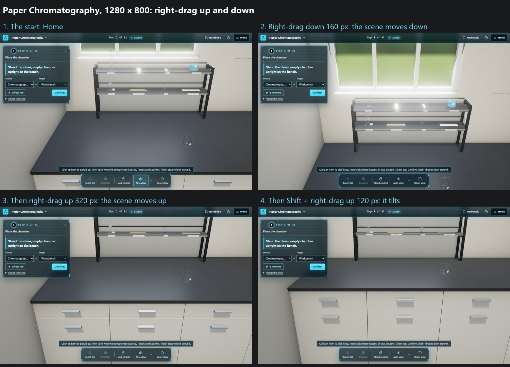

# Right-drag moves the scene up and down: evidence (2026-10-13)

You sent a screenshot of Paper Chromatography's practice version at step 3, at about 1914 × 849, with the shelf's top cut off and the cabinets filling the lower half, and wrote: "Allow user to the move the scene up-down vertically with the right-mouse button held clicked." Asked where tilting should go, you answered "Shift/Alt + right-drag (Recommended)". Asked about tablets, you answered "Yes, match right-drag (Recommended)".

3D only. 2D is unchanged: nothing under `src/player/**` or `src/styles/app.css`, and no content or generator. Not pushed or published.

## What changed

**Right-drag** moves the view with the pointer. Sideways it is unchanged: the bench point under the pointer stays under it. Up or down, the scene now follows the pointer. The camera slides along its own up direction and keeps its angle and distance, so whatever is at the look-at point's depth moves exactly as far as the pointer. Before, up or down tilted the view (the microarray lab's control, adopted 2026-10-03/04).

**Tilting** is Shift or Alt + right-drag, or a middle-drag. These already orbited, and their up and down already tilted, so no control was added.

**On a tablet**, one finger on empty bench moves the view the same way. A two-finger drag still orbits and tilts, and a pinch still zooms.

**How far.** The look-at point stays between 0.3 m below the worktop and 0.5 m above it (`MANUAL.atYMin`, `atYMax`). From Home's angle on a laptop or wider screen, that keeps the eye under the 2.0 m ceiling even at the wheel's farthest. A view already outside that range, such as a close programmatic view, is not pulled in. Home, Reset view and Auto view, whenever it frames, bring the view back level: their fits put the look-at point on the worktop.

**The help.** Controls & model now reads "Right-drag: Move the view sideways, up or down", "Shift or Alt + right-drag, or middle-drag: Orbit; drag up or down to tilt", and for touch "Drag on the empty bench: Move the view sideways, up or down" and "Two-finger drag / pinch: Orbit and tilt / zoom". The step hint's "Right-drag to look around" still holds.

The code is `panBy` in `bench/camera/benchCamera.ts`, replacing `panTiltBy`, and its two callers in `BenchEngine.ts` (the mouse and one finger). The Studio's bench views use the same engine, so they move the same way.

## The render

Paper Chromatography at 1280 × 800, from the start, with real mouse input in the page (Playwright, SwiftShader). Shot 1 is the start. Shots 2 to 4 each follow the one before. A right-drag also turns Auto view off, as any manual camera move does.

The capture is at 1280 × 800 because at 1914 × 849 the software renderer on this machine took longer than the 2-minute screenshot timeout. The control does not depend on the viewport.

## Checks

| Check | Result |
|---|---|
| `npx tsc -b` | Clean |
| `npx vitest run src/studio3d --maxWorkers=2` | 34 files, 339 tests pass (one case replaced, so the count is unchanged) |
| `benchCamera.test.ts`, replaced case | Sideways as before. 40 px down keeps yaw, pitch and distance and puts the old look-at point 40 px lower on the screen. Repeated drags stop at `atYMax` and `atYMin`. A view already higher is not pulled down. |
| `benchCamera.test.ts`, clamp case | A pan changes only the look-at point, no longer the pitch |
| `node scripts/practice3d/build.mjs --check` | Clean |
| Live page | The render above |
