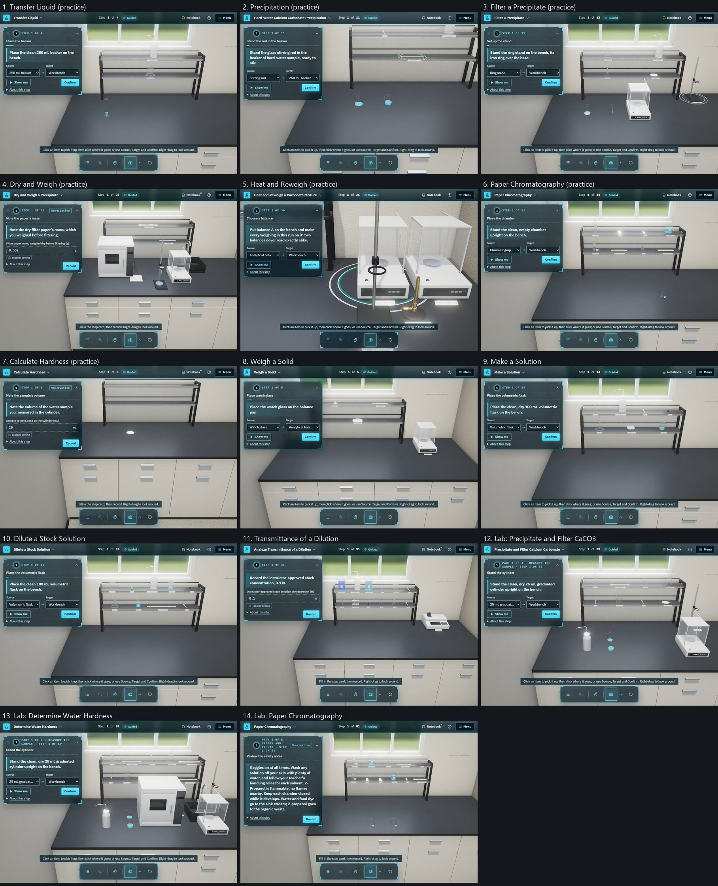
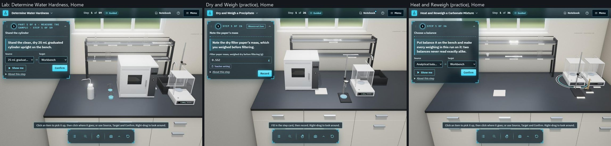

# The shelf in place of the tray: evidence (2026-10-11 to 2026-10-16)

You approved `proposals/SHELF_INSTEAD_OF_TRAY.md` in full on 2026-10-11 ("The full tray proposal is valid."): option B, a two-tier reagent shelf along the back of the bench in place of the floating tray panel, with every recommended answer. The build followed `TRAY_SHELF_BUILD_PROMPT.md` in its four phases. The build thread drew the shelf and made its items takeable (phases 1 and 2, 2026-10-11), reviewed them, and stopped for your look. It then built what you asked for next (the HUD, the natural room, the two themes, Home fitted to the screen, right-drag; each in its own `DECISIONS.md` row) and was interrupted before phase 3. A second thread finished phases 3 and 4 and these records on 2026-10-16, after you said "the tray is replaced with shelf and is done", which it takes as the look the prompt stopped for.

3D only. 2D is unchanged: `git diff 82be9f1^..HEAD -- src/runtime src/domain src/player src/styles/app.css public/techniques public/labs` is empty, and no generator was touched. The runtime's `shelf` location is unchanged; the shelf and the side station are where 3D draws what the runtime has on it. Not pushed or published.

## What was built

### Phase 1: draw (`82be9f1`, `84f531b`)

- **The shelf model** (`tools/blender/equipment/reagent_shelf.py`, D9 scenery, `SCENERY = True`, never a catalogue id): two tiers on uprights, 1200 × 180 mm, the tier tops at 300 and 520 mm and the back rod at 580 mm; 32 kB packed, under the 250,000-byte cap. The room's decorative wall shelf and its bottles are gone (`bench/look/room.ts`).
- **Where it stands** (your interpretation 1): behind the 1400 × 700 mm working area. The worktop is deepened about 130 mm at the back and the back wall moves with it, so no bench spot is lost.
- **The side station** (interpretation 2): the worktop and its cabinets run on about 600 mm past the working area's right end. Every large station stands there on a fixed spot, in start order: the analytical balance, the Bunsen burner, the ring stand and the spectrophotometer (`LARGE_STATION_IDS`). The spectrophotometer follows decision 2's rule as a fourth large station: it is 320 × 300 mm, too deep for a tier. The station holds Heat and Reweigh's four at once (two balances, a ring stand and a burner).
- **Spots** (`adapters/shelfSpots.ts`, beside `stableBench.ts`): a pure function gives every item on the runtime's shelf a spot from the start order (`stableShelfOrder`). Long items lie along a tier (the 10 mL pipette, the tongs, the stirring rod, the pencil, the ruler); items taller than the lower tier's 202 mm clearance stand on the upper tier (the 1 L bottles, the 100 mL cylinder, the wash bottle, checked against their models' built bounds, which the registry now carries). An item that reaches the shelf later goes in the middle of the widest free gap, so no start item moves for it.
- **Drawing.** Items on the shelf stand on their spots as real models at true scale, raycast on. Paper tags on the tiers' label rails and cards at the side station name them; a pale liner sits under slender items; each has an enlarged hit box and a hover name. Contact shadows ignore the shelf.
- **The beacon, Show me and Auto view** reach an item still on the shelf, in guided mode only (G-7).
- **Home** takes in the bench, the shelf and the side station.
- **The time to the first step** (SwiftShader at 1024 × 700; from "Save setup and start" to the loader leaving the page, timed in the page; six interleaved pairs, medians). The shelf's models load once the loader has gone, so they do not hold back the first step; before that deferral, `transmittance-dilution` took 5856 ms.

  | Route | With the shelf | Without (a temporary flag) | Before the build | Shelf filled after the loader |
  |---|---|---|---|---|
  | `#/3d/technique/transmittance-dilution` | 2185 ms | 2207 ms | 2225 ms | 1395 ms |
  | `#/3d/play/hard-water-demo` | 3371 ms | 3435 ms | 3161 ms | 199 ms |

### Phase 2: take (`b466757`, `f6d2039`, `c605551`)

- **Mouse and touch.** A press on a shelf item takes the item itself, through the bench's own carry (the `startTrayCarry` path). With a mouse it follows the pointer until the next press sets it down; by touch it follows the finger and sets down on lift, and a tap places it in its own slot. Setting down runs the tray's own drop intents (`dropFromTray`). A press or lift back over the shelf, Esc or a right click puts it back on its spot with nothing changed. Put it back says where: "at the side station" or "on the shelf".
- **Pours from a shelf source** lift it from its own spot and set it back there; the runtime never moves it, so nothing jumps afterwards.
- **The Shelf list** is the Bench list's shelf group: one button per item, naming its tier or the side station and, in guided mode only, what the step needs now. Enter places it (G-6).
- **The tray is gone:** the panel, its dock button, thumbnails, styles and wording. Nothing opens at the start, and the dock keeps the Bench list (interpretation 3). The canvas's arrow keys stay on the bench (interpretation 4).
- **Hand control** in the same change: the shelf items replace the tray tiles as the hand's targets, at their drawn screen positions, through the same `pickUpTile` → `startGestureTrayCarry` path.
- **Home** at 1024 × 700 aimed so the whole shelf clears the step card.

### The build thread's review of phases 1 and 2 (`32e2a82`, `177f5a5`, `b857de6`)

It found and fixed five things:

1. A pour from a shelf source had lost its animation (the Player looked for the source on the bench only). A source on a tier now slides forward off it, is carried to the target, and slides back on, so it never passes through the board above or below.
2. `f6d2039` claimed 44 px targets at Home. They were not: packed from the left, neighbours stood 11–20 px apart on screen. Each tier now holds a fair share, spread along it; at the fixed Home at 1024 × 700 the closest pair is 42–58 px apart (42 is two large models at the side station, in Heat and Reweigh). A test holds 44 px on the tiers for five techniques and two labs.
3. Put it back named no place; it now says where.
4. The hand's hover named bench items only; it names shelf items too.
5. A hover label could run under the step card; it moves past the edge of any floating panel.

Its looks (G1, 1024 × 700): Transmittance of a Dilution, the hard-water and paper chromatography labs, Heat and Reweigh at Home, the transfer's rinse, and the Studio's Starting bench.

### Between the phases

After the stop you asked for other work, each recorded in its own `DECISIONS.md` row with its own evidence, and each still waiting for your look. One of them changed the shelf: Home fitted to the screen (`74ceed7`, `HOME_FIT_EVIDENCE.md`) gave the boards the worktop's charcoal epoxy and made Home show the shelf to its top and everything on its tiers inside the free stage, at every screen size.

### Phase 3: hand (`705ef23`)

As the prompt describes, the reach is in screen space: raising the hand moves the cursor up to the tier, and a closed grip held over a shelf item picks it up (350 ms). Phase 2 had already made the shelf items the hand's targets. Phase 3 had four things to make sure of; none needed a change to the mapping, so no question was needed.

1. **A comfortable raise reaches the upper tier at Home.** The tracker's palm-to-cursor mapping is now the exported `palmCursor` in `hand/handTracker.ts` (the same formula: around the home point, at the gain, ×1.3 vertically), so a test can hold Home to it (`__tests__/home.test.ts`, "the hand reaches the shelf's upper tier at Home"). For the seven practice versions' and two techniques' start shelves, at Home on five screens (1024 × 700, 1280 × 800, 1907 × 897, and a tablet each way, 1180 × 820 and 834 × 1112):
   - at the default gain (2.2), a raise of 0.15 of the webcam frame above the home point takes the cursor above every upper-tier item's centre. The highest needs about 0.134 (Weigh a Solid at 1907 × 897), some 6 cm at arm's length; the three labs, probed the same way, need at most 0.130;
   - at the lowest gain (1), the highest needs a raise of about 0.30, and the palm is still more than 0.1 of the frame below the frame's top edge.

   The home point is the median of the first 20 frames (or Set centre), so the raise is from wherever the learner rests their hand.
2. **Aim assist takes the step's shelf item, in guided mode only (G-7).** `__tests__/handControl.test.ts`: a grip held 76 px from the expected shelf item takes it when guided; with no expected item, or with assist off, it takes nothing.
3. **The carried item is the 3D item itself.** `__tests__/shelfCarry.test.tsx`, "taking an item off the shelf by hand": a hand carry off the shelf previews the instance itself on the bench where the hand is (not a thumbnail), sets it down on release over the bench, and puts it back on its spot with nothing changed when released off the bench.
4. **The guide names the shelf.** `__tests__/player3DHandControl.test.tsx`: the gesture list reads "Close your grip over an item on the bench or the shelf and hold".

**Avoided, as the prompt asks:** the palm's lowering is still the insertion depth and plays no part in the reach; no gesture meaning was added (G-10).

**G3 is set aside.** The proposal's "G1 with the hand" cannot run in the browser without a webcam; that is G3, which stays set aside until you authorize it. Phase 3's proof is the unit and jsdom tests above. No real hand has reached the shelf yet.

### Phase 4: review (`7e8b82f`, `e6d401f`, `09d39e5`)

**The tests.** `__tests__/shelfLayout.ts` checks the 3D shelf at one moment of a run: every item on the runtime's shelf is drawn on a spot of its own, a large station at the side station and anything else on a tier within the uprights, none past the end of its space, none overlapping a neighbour, and an item that started on the shelf back on its start spot whenever it is there. It runs:

- at the start of every 3D route: the seven practice versions, the four 2D techniques that open in 3D (`weighing`, `making-solution`, `dilution`, `transmittance-dilution`) and the three labs (`__tests__/shelfRoutes.test.ts`, which also fails if a technique comes to open in 3D without a play there);
- after every step, playing each to completion: the four 2D techniques in `shelfRoutes.test.ts` with their classroom values, and the practice versions and labs in `pack2Practice`, `pack3Practice` and `lab3d`, whose plays now call it at every step.

All pass: every route starts with its items on the shelf or the side station, plays as before, and keeps its shelf laid out to the end.

**Found and fixed in the review:**

- **A hand let go off the bench said nothing.** A shelf item carried by hand and released off the bench went back to its spot silently, where the mouse says "Put back on the shelf. Nothing moved." (or "at the side station"), the wording decided at the phase 2 review (`b857de6`). The hand now says the same (`bench/input/useBenchCarry.ts`, `releaseGesture`); `shelfCarry.test.tsx` holds it to the wording.
- **An announcement could fire after the player had gone.** `usePlayer3D`'s announcement is set on a 30 ms timer; a timer still pending when a test ended fired after its page was torn down, which Vitest reported as an unhandled error (once from `shelfCarry.test.tsx`, once from `player3DHandControl.test.tsx`; every test passed). The pending timers are now cleared when the player unmounts (`player/usePlayer3D.ts`). Nothing a learner sees or hears changes: a timer cleared this way could only have set the announcement of a player already closed.

**The look** (G1, 2026-10-16). Headless Chromium with SwiftShader at 1024 × 700, in the HUD theme and guided mode. Each route was opened from its own page through its real setup (the classroom values filled in and saved), shot at its first step, and then played with the step card's Confirm for up to two steps. None logged a page or console error. The steps played:

| Route | Steps |
|---|---|
| Transfer Liquid (practice) | Place the beaker → Pour in the sample → Rinse the cylinder |
| Precipitation (practice) | Stand the rod in the beaker → Add the first portion (1 of 3) → Record what you see |
| Filter a Precipitate (practice) | Set up the stand → Seat the funnel → Zero the balance |
| Dry and Weigh (practice) | Note the paper's mass (a record step; Confirm stops there) |
| Heat and Reweigh (practice) | Choose a balance → Zero the balance |
| Paper Chromatography (practice) | Place the chamber → Label the chamber |
| Calculate Hardness (practice) | Note the sample's volume (a record step) |
| Weigh a Solid | Place watch glass → Zero the balance |
| Make a Solution | Place the volumetric flask → Seat the funnel → Tip in the solid |
| Dilute a Stock Solution | Place the volumetric flask → Pour the stock into a beaker → Fit the pipette pump |
| Transmittance of a Dilution | Record the instructor-approved stock concentration (a record step) |
| Lab: Precipitate and Filter Calcium Carbonate | Stand the cylinder → Pour to below the line → Fill the dropping pipette |
| Lab: Determine Water Hardness | Stand the cylinder → Pour to below the line → Fill the dropping pipette |
| Lab: Paper Chromatography | Review the safety notes (a record step) |

What the shots show:

- Every route starts with its items on the shelf or at the side station, right of the step card. In guided mode the ring marks the step's first item where it stands: on a tier (Transfer's beaker, Precipitation's rod, Paper Chromatography's chamber, Weigh a Solid's watch glass, the labs' 25 mL cylinder) or at the side station (Filtration's ring stand, Heat and Reweigh's balance A). Transmittance of a Dilution shows its 12 on the tiers and the spectrophotometer at the side station.
- Calculate Hardness starts with an empty shelf, as it should: its cylinder and watch glass start on the bench.
- Pours from a shelf source: Dilute a Stock Solution's stock bottle is caught sliding back onto its own tier spot after step 2's pour, and Make a Solution's weighing boat is ringed on the lower tier, framed with the flask, at step 3.
- Heat and Reweigh's step 2, shot 4 s after step 1, showed balance A half under the step card. The camera was still moving under SwiftShader: shot again 15 s after, Auto view frames balance A in the free area. Not a fault.

**Home** (Reset view) at 1024 × 700, for the routes with the most on the bench and at the side station:

Heat and Reweigh's Home takes in all ten (six on the tiers, four at the side station) right of the step card. `home.test.ts` holds its Home at 1024 × 700 to the fixed Home, but that test's step card is a conservative 374 × 416 px; the HUD card in the app is smaller, and Home fits. The oven in the other two is the first risk below.

## Risks

The prompt asks to report these, not to build past them.

- **Tall bench items hiding the shelf.** The drying oven (420 mm tall) starts at the back of the working area, in its slot from 2D's layout, in front of the shelf. At Home at 1024 × 700 (the render above, and each spot projected through Home's camera), it hides:
  - in the hard-water lab, three lower-tier items wholly (a Beral pipette, the filter paper, the watch glass) and half of the scoopula;
  - in Dry and Weigh, the watch glass.

  The ring on a hidden item is hidden with it. Each stays takeable from the Shelf list and through the step card's Source and Target, and can be seen by orbiting or from Overhead. Whether Auto view's framing of such an item clears the oven was not checked. What to do is your decision; not built: leave it; give the shelf spots a rule that avoids what a tall bench item hides; or start the oven elsewhere on the bench in 3D.
- **More than about 14 shelf items.** Pack 3b's brass content has 29 on the 2D shelf. The two tiers will not hold them; it needs a third tier or a second bay, which is your decision when Pack 3b is built.
- **Tiny items** (the cuvettes, the stopper, the pencil, the capillary) stay hard to see at Home even with their tags and liners, most at 1024 × 700.
- **The side station in Heat and Reweigh.** Its four stand close. At the fixed Home at 1024 × 700 the ring stand and the burner were 42 px apart, under the tiers' 44 px. At Home now, the ring stand stands in front of balance A and the burner in front of balance B. Each stays in view and takeable, and the Shelf list names each.
- **Steps whose items are all on the shelf.** Auto view keeps the previous view at such a step (found 2026-10-13, `HOME_FIT_EVIDENCE.md`). It frames a shelf item together with any bench item the step names. Whether a shelf-only step should go to Home, frame the shelf item close up, or stay as it is waits for your answer.
- **`probes/place-from-tray.cjs` is stale.** It targets the tray panel, which is gone; the Shelf list needs its own selectors.

## Checks

For phase 4 and the records (2026-10-16):

| Check | Result |
|---|---|
| `npx tsc -p tsconfig.app.json --noEmit` | Clean |
| `npx tsc -b` | Clean |
| `npx vitest run src/studio3d --maxWorkers=3` | 35 files, 358 tests pass, run twice with no unhandled error (one error, from the announcement timer, before its fix) |
| New `__tests__/shelfRoutes.test.ts` | The 14 routes start laid out; the four 2D techniques play to completion with the shelf laid out at every step; a technique that comes to open in 3D without a play here fails it |
| `pack2Practice`, `pack3Practice`, `lab3d` | Their plays check the shelf at the start and after every step |
| `shelfCarry.test.tsx`, hand case | A hand carry let go off the bench says "Put back on the shelf. Nothing moved." |
| `node scripts/practice3d/build.mjs --check` | Clean |
| `py tools/blender/validate_equipment3d.py --pack 3` | PASS: 12 definitions, 0 failures |
| `npm run content:check` | 22 violations, the existing baseline |
| `git diff 82be9f1^ -- src/runtime src/domain src/player src/styles/app.css public/techniques public/labs` | Empty: the runtime and 2D are unchanged since the shelf build began |
| Live page (Playwright, SwiftShader, 1024 × 700) | The 14 routes and the Home shots above, no page or console errors |
